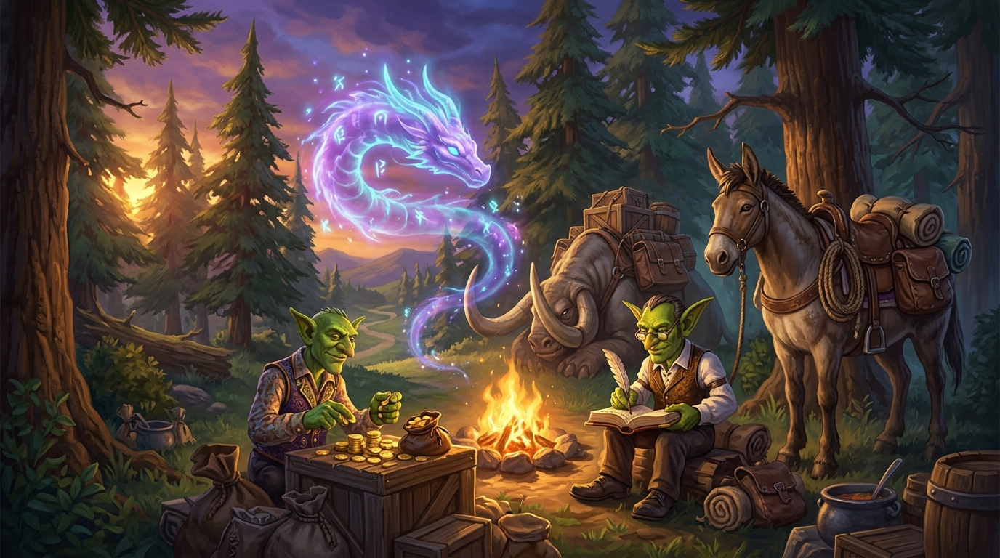

# mod-twow-QOL-followers



[](https://turtle-wow.org/)
[-blue.svg)]()
[]()
[-brightgreen.svg)]()
[](LICENSE)

`mod-twow-QOL-followers` is a standalone Turtle WoW custom vMaNGOS module (targeting client 1.18.1 build 7272) that provides players with summonable quality-of-life companion followers for essential town and field services across Azeroth.

The module introduces three distinct utility companions: a faction-tailored Banker (Alliance Pack Mule / Horde Pack Kodo), an Auctioneer (Auctioneer Beardo), and the Kirin Tor Familiar offering full class training, profession training, talent resets, multi-spec management, and worldwide fast-travel teleportation.

---

## Companions and Services

| Follower | Creature ID | Native Summon Spell | Appearance | Main Services |
| :--- | :---: | :---: | :---: | :--- |
| **Banker (Alliance)** | `70100` | 46459 (*Forworn Mule*) | Pack Mule (Display `14546`) | Opens personal bank storage vault anywhere in the world. |
| **Banker (Horde)** | `70103` | 46483 (*Caravan Kodo*) | Pack Kodo (Display `7933`) | Opens personal bank storage vault anywhere in the world. |
| **Auctioneer** | `70101` | 46460 (*Mechanical Auctioneer*) | Auctioneer Beardo (Display `7993`) | Opens global Auction House browsing, bidding, and listing. |
| **Kirin Tor Familiar** | `70104` | 46465 (*Kirin Tor Familiar*) | Kirin Tor Familiar (Display `14432`) | Class training, profession training, talent reset, pet training reset, multi-spec, and teleportation. |

### Kirin Tor Familiar Teleportation Network
The Kirin Tor Familiar provides fast-travel teleportation to verified open-world entrance coordinates:
- **Alliance Capitals**: Stormwind City, Ironforge, Darnassus.
- **Horde Capitals**: Orgrimmar, Undercity, Thunder Bluff.
- **Neutral Hubs**: Booty Bay, Gadgetzan, Ratchet, Everlook.
- **Classic Dungeons**: Ragefire Chasm, The Deadmines, Wailing Caverns, Shadowfang Keep, Blackfathom Deeps, The Stockade, Gnomeregan, Razorfen Kraul, Scarlet Monastery, Razorfen Downs, Uldaman, Zul'Farrak, Maraudon, Sunken Temple, Blackrock Depths, Lower Blackrock Spire, Dire Maul, Scholomance, Stratholme.
- **Classic Raids**: Molten Core, Onyxia's Lair, Blackwing Lair, Zul'Gurub, Ruins of Ahn'Qiraj, Temple of Ahn'Qiraj, Naxxramas.

---

## Movement and Behavior

- **Native Engine Follow**: Companions follow their owner using vMaNGOS `MotionMaster` `MoveFollow` at a comfortable 3.0 yard offset without hysteresis stutter.
- **Interaction Distraction**: Companions automatically pause movement while their owner is interacting with gossip, bank, auction, or trainer windows (`UNIT_STAT_DISTRACTED`).
- **Catch-Up Recovery**: If the player mounts or teleports, the companion instantly catches up when distance exceeds 30 yards.
- **Single-Entity Guarantee**: Core vanity mini-pet summons triggered by Effect 97 (`SPELL_EFFECT_SUMMON_CRITTER`) are intercepted and suppressed synchronously via `PetScript`, ensuring only the interactive utility follower exists.
- **The Unediting Doctrine**: 100% standalone and non-intrusive. Zero core edits or patches to `tortoise-wow` or `TortoiseBots`.

---

## Summoning Methods

### 1. Native Spellbook Spells
Spells are automatically learned upon character creation (configurable minimum level, default: Level 1):
- **Banker (Alliance)**: Spell `46459` (*Forworn Mule*)
- **Banker (Horde)**: Spell `46483` (*Caravan Kodo*)
- **Auctioneer**: Spell `46460` (*Mechanical Auctioneer*)
- **Kirin Tor Familiar**: Spell `46465` (*Kirin Tor Familiar*)

Casting a spell summons the corresponding companion. Casting the spell again dismisses the companion. Spells can be dragged directly onto action bars.

### 2. Player Chat Commands
Players can also summon and dismiss followers via in-game chat commands:
- `.utility banker` (or `.utility bank`) - Toggle personal banker companion.
- `.utility auctioneer` (or `.utility ah`) - Toggle personal auctioneer companion.
- `.utility helper` (or `.utility familiar`) - Toggle Kirin Tor Familiar companion.
- `.utility dismiss [all|banker|auctioneer|helper|familiar]` - Dismiss active followers.
- `.utility reload` - Reload module configuration (Game Master security level required).

---

## Requirements

- **Server Engine**: Turtle WoW custom vMaNGOS core (`tortoise-wow` targeting client 1.18.1 build 7272).
- **Database**: MariaDB 10.5+ or MySQL 5.7+ (`world` database).
- **Build System**: CMake 3.16+ and a C++17 compatible compiler (MSVC 2022 on Windows, GCC 10+ / Clang 11+ on Linux).

---

## Installation

The module integrates seamlessly as a standalone vMaNGOS module without requiring any patches or core modifications.

### Step 1: Install the Module Source

Place `mod-twow-QOL-followers` inside the `modules` directory of your `tortoise-wow` source repository.

#### Option A: Clone repository into `modules/` (Standard Setup)
```bash
cd /path/to/tortoise-wow/modules
git clone https://github.com/Ildourol/mod-twow-QOL-followers.git mod-twow-QOL-followers
```

#### Option B: Directory Junction / Symlink (Recommended for Modular Development)
If you maintain modules in an external workspace, create a directory junction or symbolic link into `tortoise-wow/modules/`:

**Windows (PowerShell / Command Prompt as Administrator):**
```cmd
mklink /J "C:\path\to\tortoise-wow\modules\mod-twow-QOL-followers" "C:\Users\Admin\AntigravityProfiles\Projects Twow\Turtle wow modules\mod-twow-QOL-followers"
```

**Linux / macOS:**
```bash
ln -s /path/to/mod-twow-QOL-followers /path/to/tortoise-wow/modules/mod-twow-QOL-followers
```

Your resulting source directory structure:
```text
tortoise-wow/
├── modules/
│   └── mod-twow-QOL-followers/
│       ├── conf/
│       │   └── mod_qol_followers.conf.dist
│       ├── data/
│       │   └── sql/world/
│       │       └── 20261030000000_world_qol_followers.sql
│       ├── docs/
│       │   └── ARCHITECTURE.md
│       ├── src/
│       │   ├── mod_QOL_followers_loader.cpp
│       │   └── ...
│       ├── CMakeLists.txt
│       ├── preview.jpg
│       └── README.md
```

### Step 2: Apply Database Migration

Import the SQL migration file into your **`world`** database (e.g. `world` or `tw_world`):

**Linux / Bash:**
```bash
mysql -u root -p world < modules/mod-twow-QOL-followers/data/sql/world/20261030000000_world_qol_followers.sql
```

**Windows / PowerShell:**
```powershell
Get-Content .\modules\mod-twow-QOL-followers\data\sql\world\20261030000000_world_qol_followers.sql | mysql -u root -p world
```

> [!NOTE]
> This migration registers creature templates `70100` (Pack Mule Banker), `70103` (Pack Kodo Banker), `70101` (Auctioneer Beardo), and `70104` (Kirin Tor Familiar Trainer & Teleporter). It is idempotent and safe to apply on top of fresh databases.

### Step 3: Configure CMake and Build `mangosd`

Configure CMake to include the module and build the world server binary:

#### Linux (Ubuntu 22.04 / 24.04 LTS):
```bash
cd /path/to/tortoise-wow
mkdir -p build && cd build
cmake .. -DCMAKE_BUILD_TYPE=Release -DMODULE_MOD_TWOW_QOL_FOLLOWERS=static
cmake --build . --target mangosd -j$(nproc)
```

#### Windows (Visual Studio 2022 / MSVC):
```powershell
cd C:\path\to\tortoise-wow
cmake -S . -B build -G "Visual Studio 17 2022" -A x64 -DMODULE_MOD_TWOW_QOL_FOLLOWERS=static
cmake --build build --config Release --target mangosd --parallel
```

### Step 4: Deploy Configuration

Copy the distributed template `mod_qol_followers.conf.dist` to your server's module configuration directory:

```bash
# Beside other module configs (e.g. bin/etc/modules/ or bin/etc/)
cp modules/mod-twow-QOL-followers/conf/mod_qol_followers.conf.dist bin/etc/modules/mod_qol_followers.conf
```

Or alongside `mangosd.conf`:
```bash
cp modules/mod-twow-QOL-followers/conf/mod_qol_followers.conf.dist bin/mod_qol_followers.conf
```

### Step 5: Verify Server Startup

Launch `mangosd` and verify the module initialization messages in the console log:

```text
mod-QOL-followers: Loading Utility Followers configuration...
mod-QOL-followers: Validating creature templates...
mod-QOL-followers: Startup validation complete.
```

In-game, test the system using:
- `.utility banker` (or `.utility bank`)
- `.utility auctioneer` (or `.utility ah`)
- `.utility helper` (or `.utility familiar`)
- Or cast the companion summon spells directly from your character's Spellbook!

---

## Configuration Reference

The module is highly customizable via `mod_qol_followers.conf`:

| Setting | Default | Description |
| :--- | :---: | :--- |
| `UtilityFollowers.Enable` | `1` | Master toggle for the entire QoL followers system. |
| `UtilityFollowers.Banker.Enable` | `1` | Enables or disables the personal Banker companion. |
| `UtilityFollowers.Auctioneer.Enable` | `1` | Enables or disables the personal Auctioneer companion. |
| `UtilityFollowers.Trainer.Enable` | `1` | Enables or disables the Kirin Tor Familiar (Trainer & Teleporter). |
| `UtilityFollowers.FollowDistance` | `3.0` | Steady-state distance (yards) the companion maintains behind the player. |
| `UtilityFollowers.StartFollowingDistance` | `4.0` | Deadzone distance (yards) before the follower starts moving. |
| `UtilityFollowers.CatchUpDistance` | `30.0` | Maximum distance before triggering instant catch-up teleport. |
| `UtilityFollowers.FollowUpdateInterval` | `300` | Movement tracking evaluation interval in milliseconds. |
| `UtilityFollowers.TeleportWhenStuck` | `1` | Enables automatic teleportation recovery when pathing is blocked. |
| `UtilityFollowers.MaxActive` | `1` | Maximum simultaneous utility companions per player. |
| `UtilityFollowers.MaxActivePolicy` | `"ReplaceOldest"` | Despawn behavior when exceeding cap (`"ReplaceOldest"` or `"Reject"`). |
| `UtilityFollowers.AllowInWorld` | `1` | Allows companion summoning in the outdoor open world. |
| `UtilityFollowers.AllowInDungeons` | `1` | Allows companion summoning in 5-man dungeons. |
| `UtilityFollowers.AllowInRaids` | `1` | Allows companion summoning in raid instances. |
| `UtilityFollowers.AllowInBattlegrounds` | `0` | Disallows companion summoning inside Battlegrounds. |
| `UtilityFollowers.AllowInArenas` | `0` | Disallows companion summoning inside Arenas. |
| `UtilityFollowers.Banker.Spell.AutoLearn` | `1` | Automatically teaches Banker summon spell to characters on creation / login. |
| `UtilityFollowers.Auctioneer.Spell.AutoLearn` | `1` | Automatically teaches Auctioneer summon spell to characters on creation / login. |
| `UtilityFollowers.Trainer.Spell.AutoLearn` | `1` | Automatically teaches Kirin Tor Familiar summon spell to characters on creation / login. |
| `UtilityFollowers.Spells.DefaultLearnLevel` | `1` | Minimum character level required to auto-learn companion summon spells. |
| `UtilityFollowers.Spells.SyncOnLogin` | `1` | Synchronizes and grants any missing companion spells upon player login. |
| `UtilityFollowers.Trainer.FreeTraining` | `0` | Whether class and profession training spells cost 0 copper (`0` = Normal, `1` = Free). |
| `UtilityFollowers.Trainer.FreeTalentReset` | `0` | Whether resetting talents through Kirin Tor Familiar is free of cost (`0` = Normal, `1` = Free). |
| `UtilityFollowers.Trainer.Teleport.Enable` | `1` | Master switch for Kirin Tor Familiar fast-travel teleportation services. |
| `UtilityFollowers.Trainer.Teleport.Cost` | `0` | Copper cost charged per teleportation (`0` = Free). |
| `UtilityFollowers.Trainer.Teleport.MinLevel` | `1` | Minimum character level required to use teleportation. |
| `UtilityFollowers.Trainer.Teleport.EnableExtraLocations` | `1` | Enables neutral and quest hubs (Booty Bay, Gadgetzan, Ratchet, Everlook). |
| `UtilityFollowers.Trainer.Teleport.EnableDungeons` | `1` | Enables Classic Vanilla 5-player dungeon entrances. |
| `UtilityFollowers.Trainer.Teleport.EnableRaids` | `1` | Enables Classic Vanilla raid entrances. |

---

## License

This module is released under the GNU General Public License v2 (or at your option any later version).
